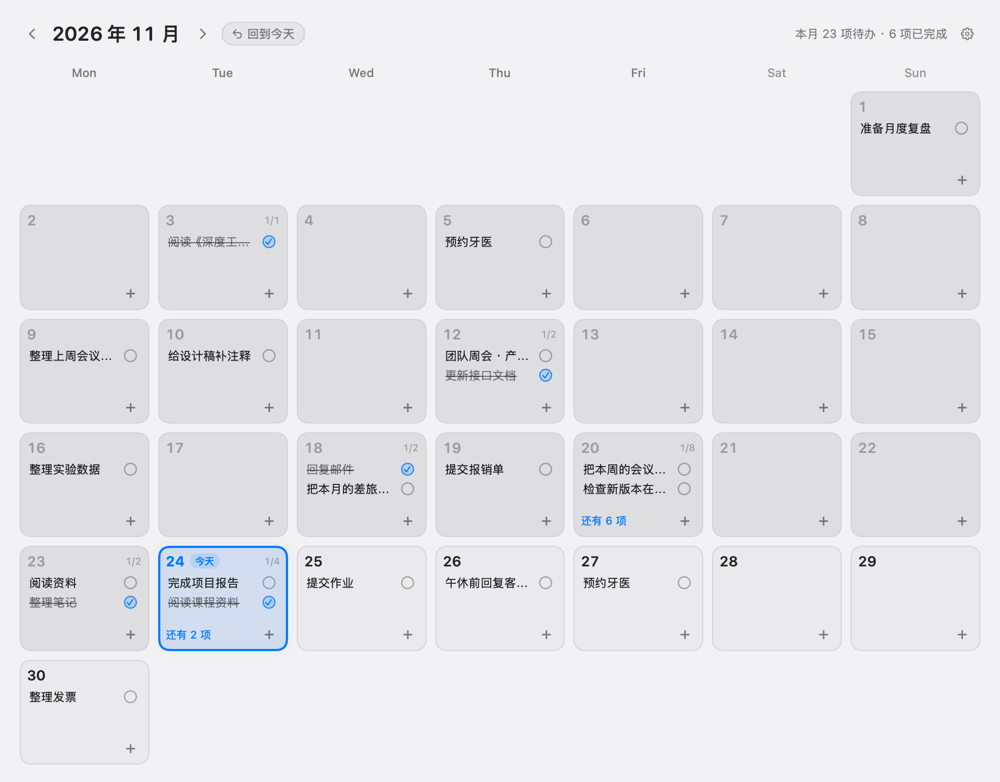
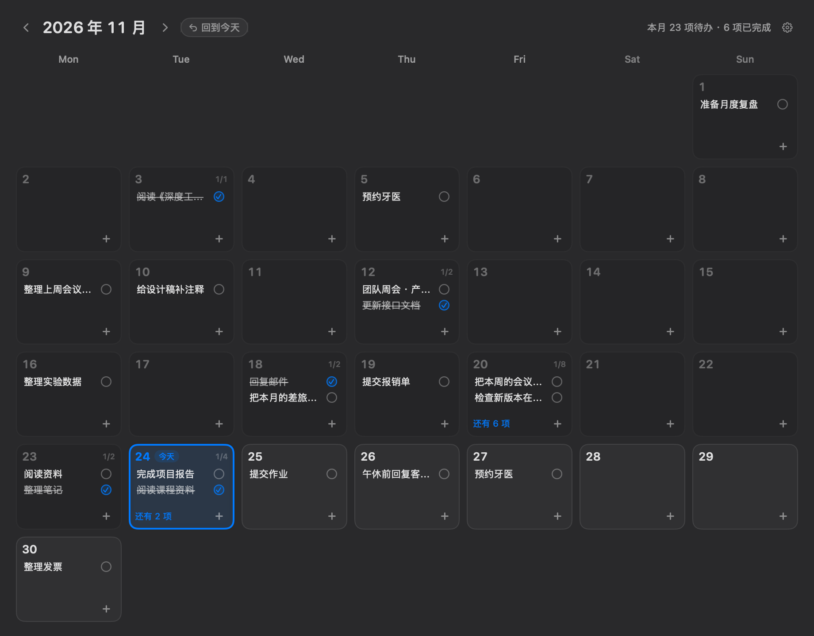
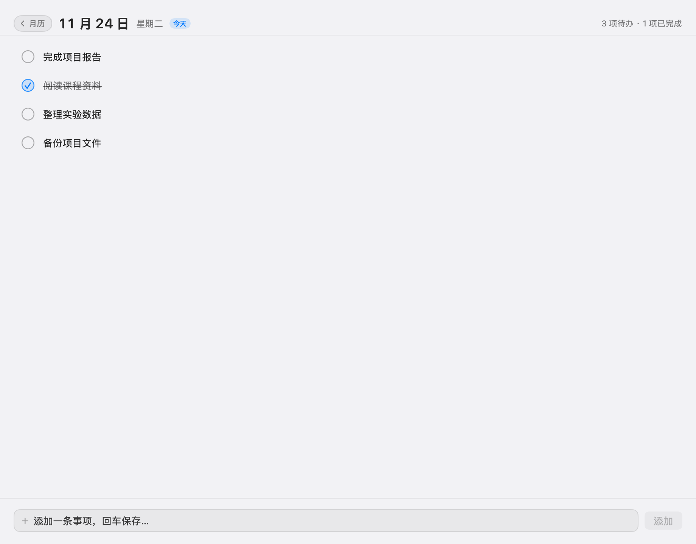
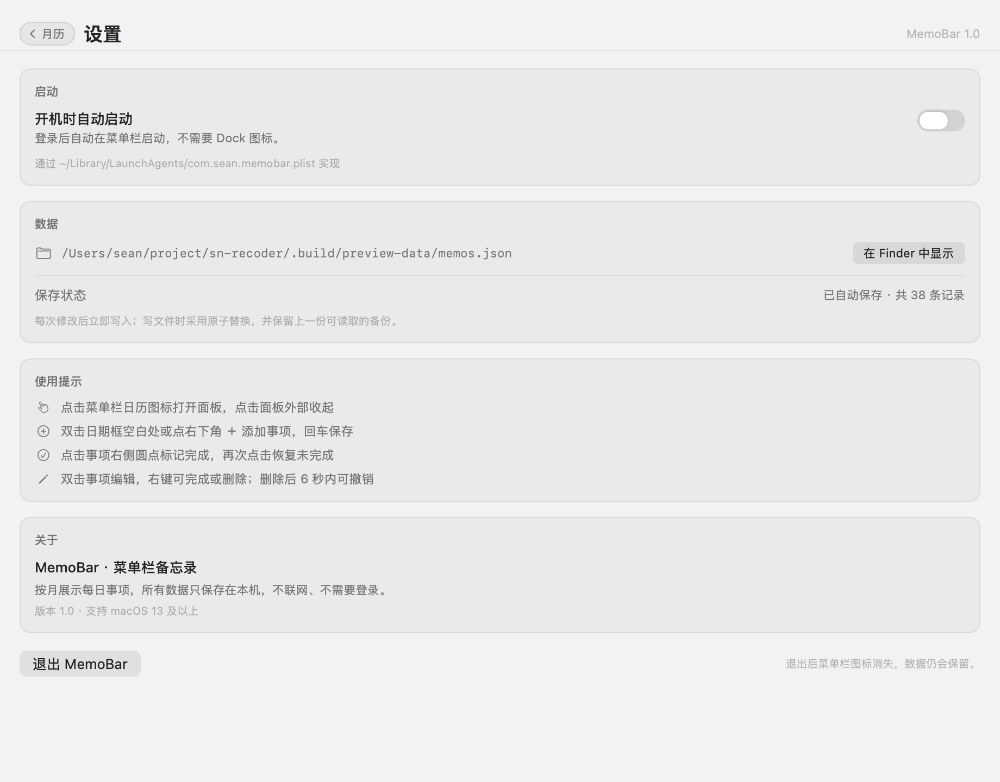
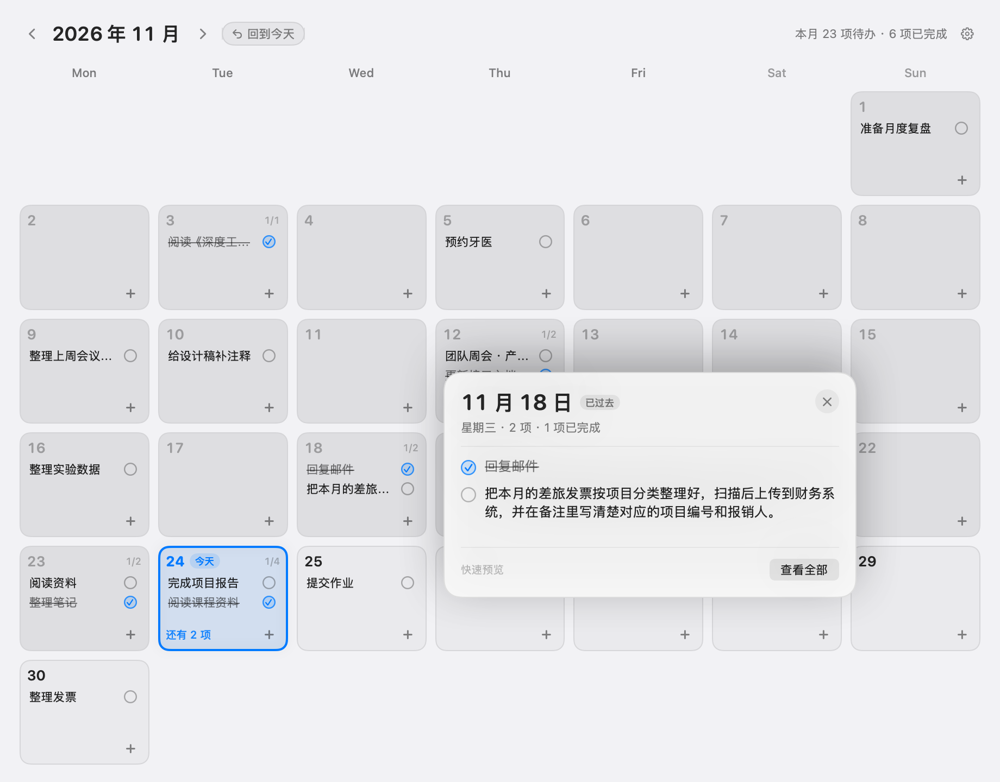
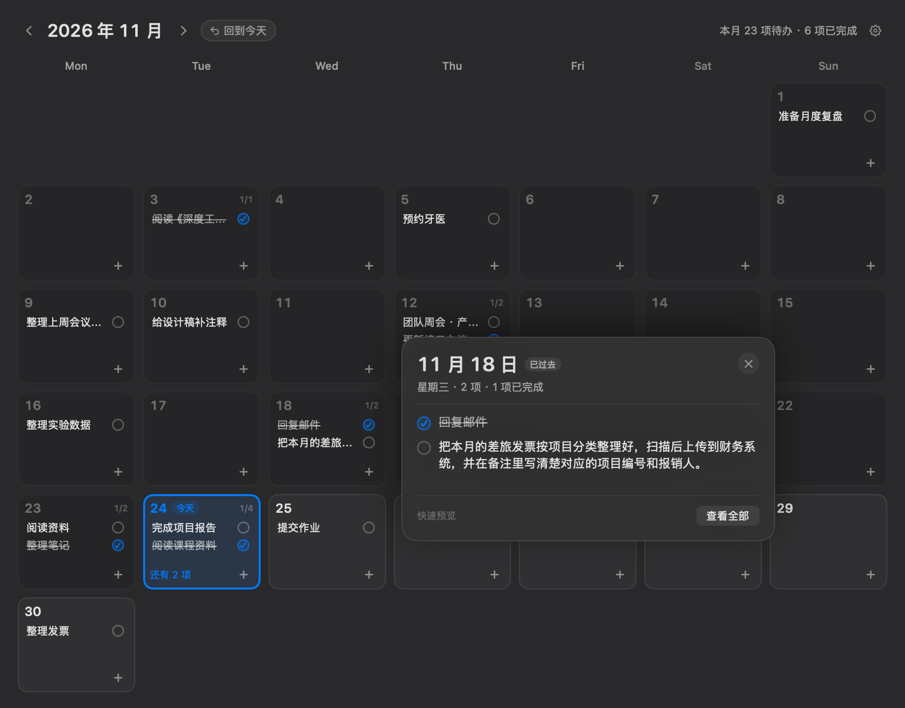
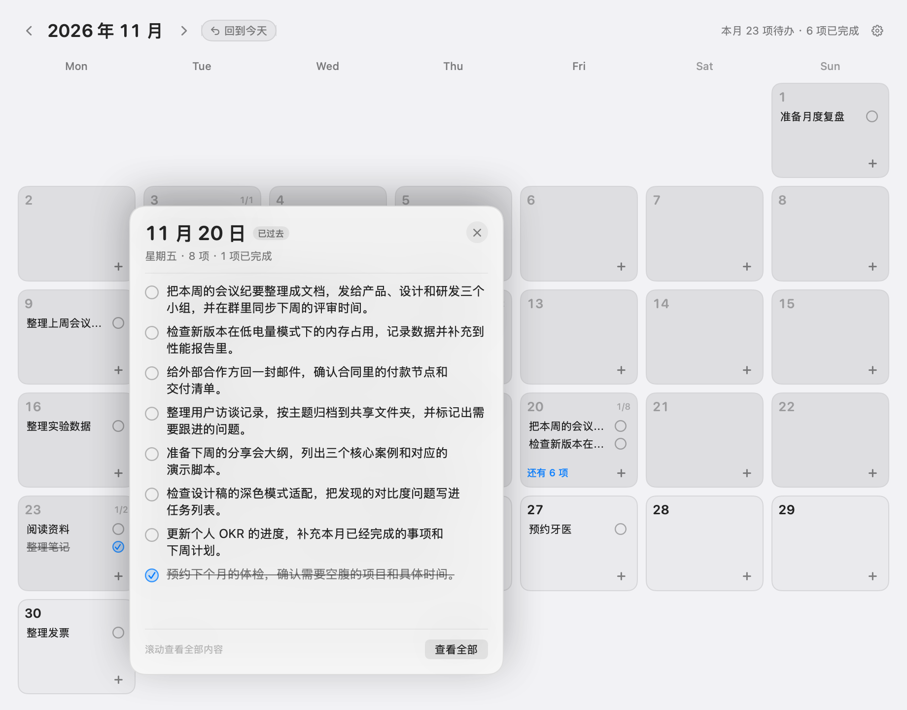
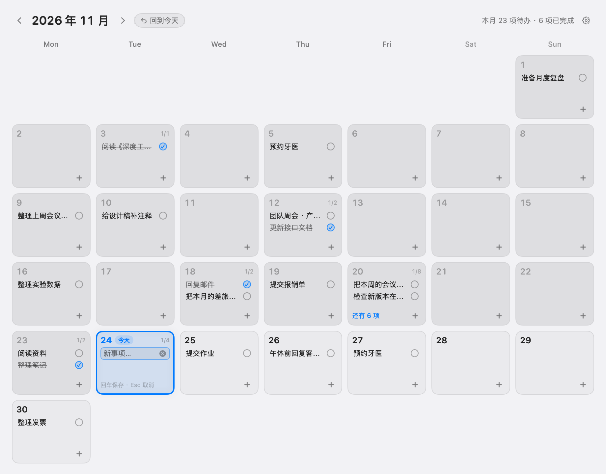

# MemoBar · macOS Menu Bar Memo

**English** | [中文](README.md)

A lightweight memo app that lives in the macOS menu bar. The month is laid out as a Monday-first grid where every day owns its own box, and memos can be added, completed, edited and deleted. Resting the pointer on a day opens a Quick Look–style enlarged card, so long notes are readable in full.

The v1 interface copy is Chinese, while the calendar header uses English weekday abbreviations (Mon–Sun). Built with Swift and SwiftUI, no third-party dependencies. The app bundle is about **1.6 MB** including the icon.



## Features

- **Menu bar first**: a `MenuBarExtra` window opens from the calendar icon and closes on an outside click. No Dock icon.
- **Month grid**: fixed **Mon–Sun** columns, 4–6 rows depending on the month, one box per day, equal heights within a month. The main page has no bottom text — just the calendar.
- **Today and past**: today uses an accent border, a tinted background and a "今天" badge; past day boxes and date numbers are muted, while their memos stay editable and checkable.
- **Memos**: add inline with the `＋` button or by **double-clicking empty space** in a day box; Enter saves, Esc cancels. The round button on the right toggles completion, and completed text turns gray with a strikethrough.
- **Day detail**: click a date number or "还有 N 项" to open the full list for that day, where long text can be edited and deleted.
- **Hover quick look**: rest the pointer on a day with memos for about 0.4 s; an enlarged card appears beside the box and shows every memo with full wrapping. Move into the card to scroll, or open the day via "查看全部".
- **Undo delete**: a 6-second undo pill appears after deleting a memo.
- **Month navigation**: previous/next month and "回到今天"; year boundaries work.
- **Local persistence**: `~/Library/Application Support/MemoBar/memos.json`, with atomic writes and a readable backup; corrupt files are preserved and recovered.
- **Date refresh**: a midnight timer, `NSCalendarDayChanged`, time-zone/clock changes and wake notifications refresh "today".
- **System integration**: light/dark mode, launch at login, a settings page and a quit button.

| Dark month view | Day detail | Settings |
| --- | --- | --- |
|  |  |  |

### Hover quick look

The card appears after a ~0.4 s hover, avoids covering the hovered day box, and picks the side with more room.

| Light | Dark |
| --- | --- |
|  |  |

Long days are capped to a scrollable area; the "查看全部" button opens the day detail:



## Quick start

Requirements: macOS 13 or later and Xcode Command Line Tools (`xcode-select --install`). No Xcode project is required.

```bash
# Build and launch (stops the previous instance first)
make run

# Build only
make build

# Run the model/persistence tests
make test

# Render UI snapshots to build/previews/
make preview
```

The app is written to `build/MemoBar.app`; drag it to `/Applications` if you like. On first launch, a calendar icon appears in the menu bar.

## Usage

| Action | How |
| --- | --- |
| Add a memo | Double-click empty space in a day box, or click `＋`; Enter saves, Esc cancels |
| Complete / restore | Click the round button on the right of a memo |
| Edit | Double-click memo text, or right-click → Edit; double-clicking in the month opens the day detail in edit mode |
| View all | Click the date number or "还有 N 项"; the hover card also has "查看全部" |
| Quick look | Hover a day box for ~0.4 s; move into the card to scroll, click × or move away to dismiss |
| Delete | Trash button on hover, or right-click → Delete |
| Undo delete | Bottom pill after deletion, available for 6 seconds |
| Switch month | Arrow buttons in the header; "回到今天" jumps back |
| Settings | Gear icon: launch at login, data location, tips, quit |

Double-click empty space in a day box or click `＋` to open the inline editor:



## Data & backups

- Data directory: `~/Library/Application Support/MemoBar/`
- Main file: `memos.json` (`schemaVersion` + an array of memos)
- Backup: `memos.backup.json`; before each save, the current readable file is copied to the backup slot
- Writes are atomic (temporary file + replace)
- If the main file is unreadable: the backup is tried first; if usable it is restored and written back, and the damaged file is kept as `memos.corrupt-<timestamp>.json`
- If a save fails, changes remain in memory and the panel shows a retry banner

Memo fields: `id`, `dateKey` (for example `2026-11-24`), `text`, `isCompleted`, `sortOrder`, `createdAt`, `updatedAt`. Dates are stored as date strings rather than timestamps, so a time-zone change cannot move a memo to another day.

## Launch at login

The settings toggle uses a per-user LaunchAgent:

```text
~/Library/LaunchAgents/com.sean.memobar.plist
```

`ProgramArguments` points at the app executable and `RunAtLoad` is `true`. This works for local, unsigned builds, where `SMAppService.mainApp` may fail outside `/Applications`. If you move the app later, toggle the setting off and on again to refresh the path.

## Project layout

```text
.
├── MemoBar
│   ├── App/MemoBarApp.swift          # @main, MenuBarExtra, AppDelegate
│   ├── Models
│   │   ├── DateKey.swift             # date keys, Monday-first calendar, date copy
│   │   ├── MemoItem.swift            # memo and database models
│   │   ├── MonthGrid.swift           # month grid (leading blanks, rows, days)
│   │   └── PanelMetrics.swift        # fixed panel geometry
│   ├── Services
│   │   ├── MemoFileStore.swift       # atomic JSON I/O, backups, corruption recovery
│   │   └── LaunchAtLogin.swift       # LaunchAgent login item
│   ├── Stores
│   │   ├── MemoStore.swift           # memo CRUD and persistence
│   │   └── PanelModel.swift          # panel navigation, inline editing, undo, date refresh, hover state
│   ├── Views
│   │   ├── RootPanelView.swift       # routing and overlay layers
│   │   ├── MonthCalendarView.swift   # month header, Mon–Sun strip, grid
│   │   ├── DayBoxView.swift          # one day box, double-click-to-add
│   │   ├── ItemRows.swift            # compact rows and inline input
│   │   ├── DayDetailView.swift       # full day list
│   │   ├── HoverPreviewView.swift    # hover card, placement, scrolling, hover bridge
│   │   ├── SettingsView.swift        # settings
│   │   ├── Theme.swift               # colors and shared controls
│   │   └── UndoToast.swift           # delete undo pill
│   └── Resources
│       ├── Info.plist
│       ├── AppIcon.icns
│       └── AppIcon-1024.png
├── Tests/MemoBarTests.swift          # 55 model, persistence and hover-state checks
├── Tools/PreviewRender/PreviewRenderer.swift  # offscreen NSWindow snapshot tool
├── scripts                           # build / test / preview / icon
├── docs/screenshots                  # README images
├── Makefile
├── README.md                         # 中文说明
└── README.en.md                      # English readme
```

## Implementation notes

- The panel is **920 × 720 pt** with seven columns. Row height fills the grid, so 4-row months are airier and 6-row months still fit.
- A day box previews 2 memos (3 on 4/5-row months); overflow shows "还有 N 项".
- One `MenuBarExtra` panel hosts the month, day detail and settings — no stacked popovers.
- Closed panels do no polling; date refresh relies on system notifications plus a single midnight timer.
- Double-clicking empty space is a background-layer gesture; buttons, date numbers and memo text keep their own click/double-click behavior.
- The hover card uses a 0.4 s intent delay, flips to the side with more room, and is clamped inside the panel so it never covers the hovered box. The day box and the card report hover independently, and the card hides only when both are left. The card grows to fit its content and scrolls internally beyond 360 pt.
- Completed text keeps readable contrast in both appearances; unfinished memos on past dates keep normal text color.
- The UI uses system fonts and SF Symbols, with no image assets or UI frameworks.

## Verification

- `make test`: **55 checks pass**, covering leap February, 4/5/6-row months, year boundaries, the Mon–Sun header, CRUD, completion, ordering, restart recovery, atomic saves, backup recovery, corrupt-file preservation, and both hover event orderings.
- Offscreen renders check light/dark month views, 4- and 6-row months, inline add, editing, empty states, undo, settings, and the hover card with a long scrollable list.
- Real window events confirm that double-clicking empty space opens the inline editor.
- A real build shows a visible menu bar `NSStatusBarWindow` (32 × 33 pt, occlusion state includes visible) and runs as a `UIElement` with no Dock icon; a real hover shows a truncated title in full in the card. Resident memory is about 75 MB (mostly the SwiftUI/AppKit runtime).

## Known limitations

- Local-only data for now: no notifications, repeating memos, search, import/export, iCloud sync or global hotkey.
- The window is fixed at 920 × 720; the calendar does not yet scroll vertically on very small screens or with very large system fonts.
- The hover preview appears only on days with memos; the card is capped at about 380 × 480 pt, so extremely long content must be scrolled or opened in the day detail.
- `Esc` cancels inline input and editing; click the icon or outside the panel to close it.
- The build script builds for the current machine architecture (arm64 on Apple Silicon). On an Intel Mac, run the same `make build`.
- There is no `.xcodeproj`; the app is packaged with `swiftc` and `scripts/build.sh` to keep the bundle small. Migrating to an Xcode project later is straightforward.

## Roadmap

- Reminders and repeating rules in the day detail
- Panel/global keyboard shortcut
- Search and cross-month lookup
- Editing and completing memos directly from the hover card
- A denser single-line mode or a week view
- One-click restore from backup / Markdown export
