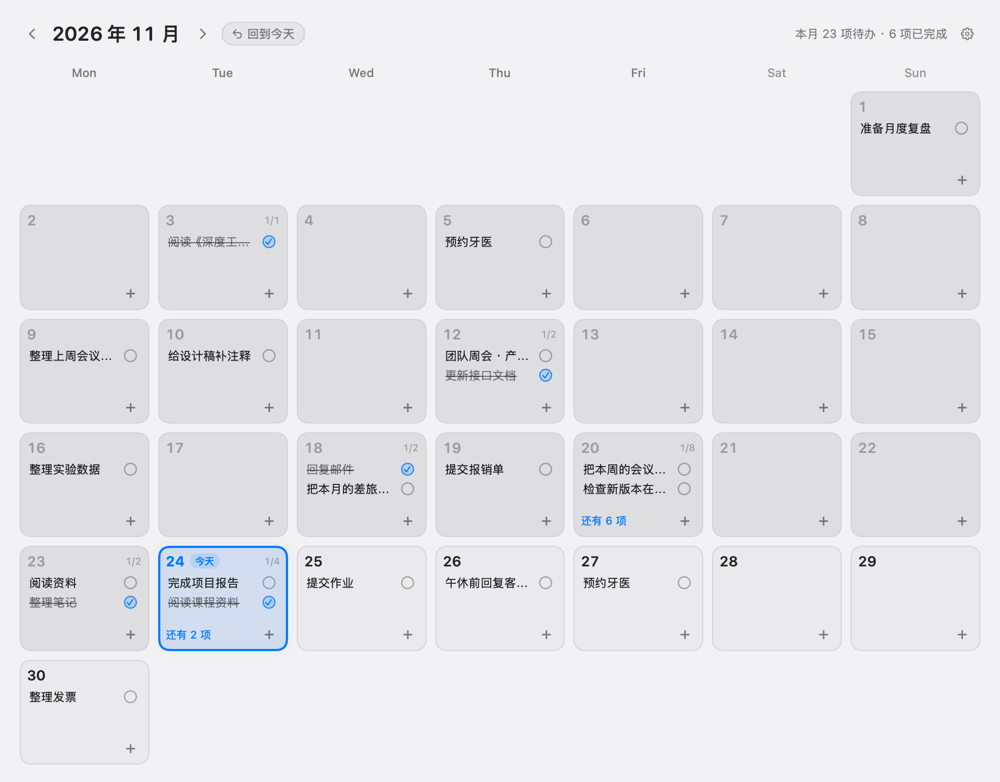
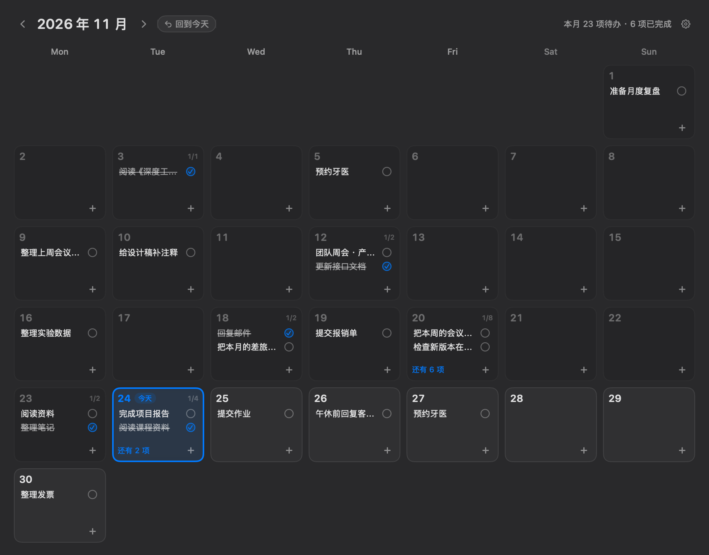
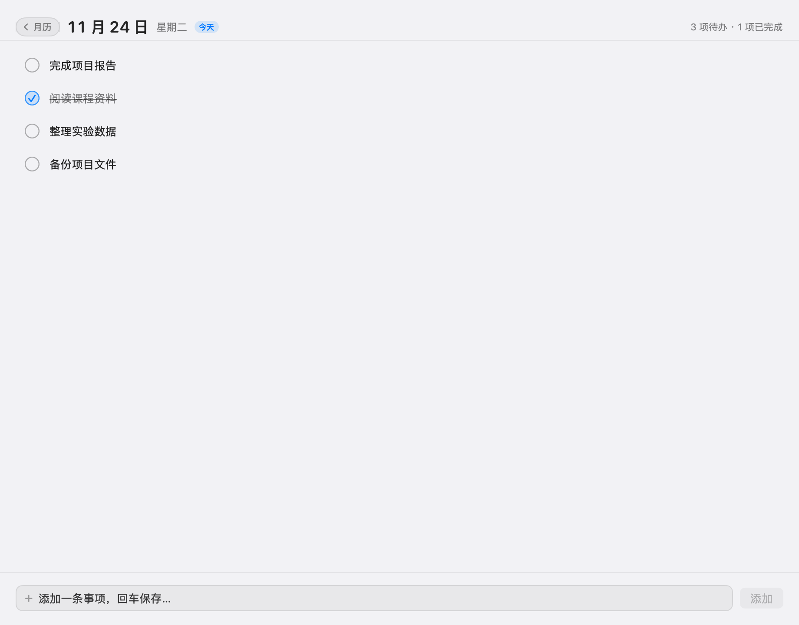
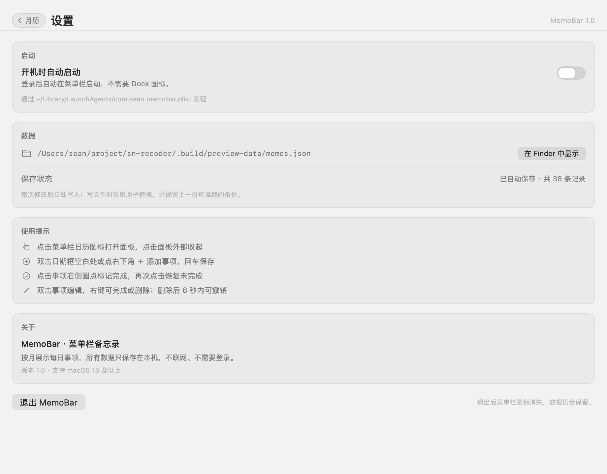
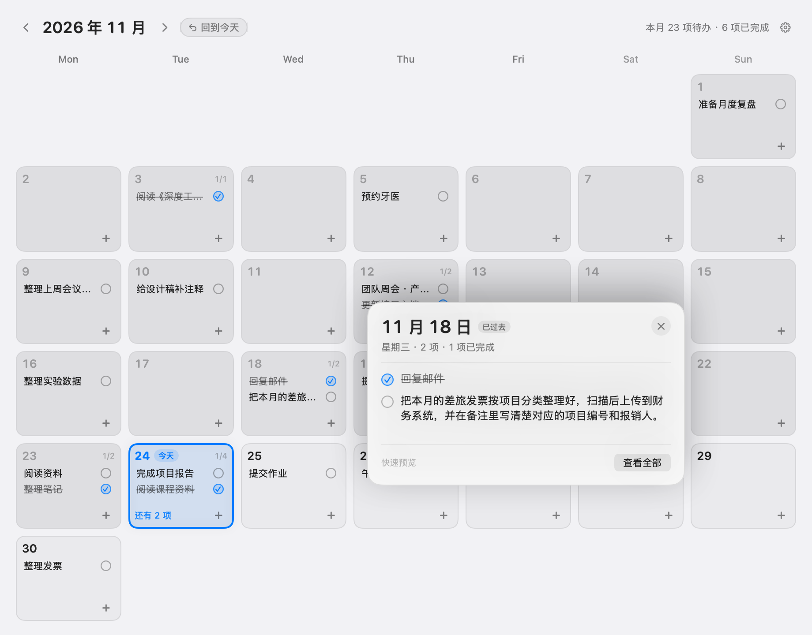
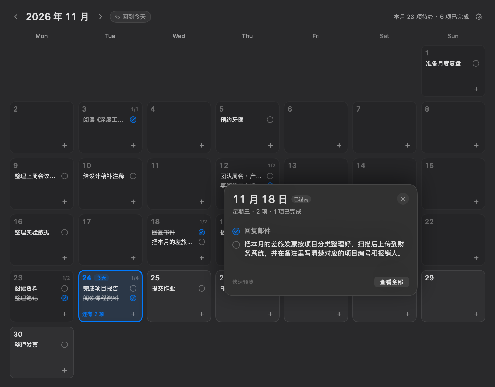
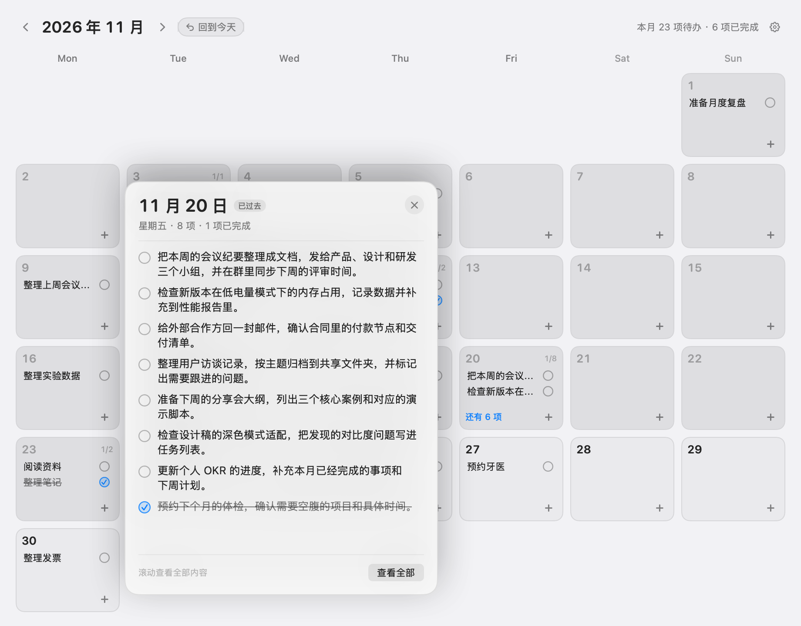
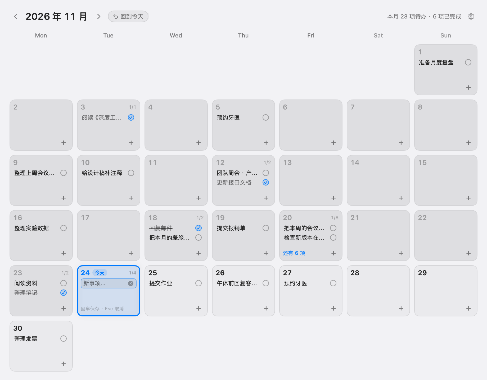

# MemoBar · macOS 菜单栏备忘录

**中文** | [English](README.en.md)

一个常驻 macOS 右上角菜单栏的轻量备忘录：按月展示每天的事项，以「一天一个方框」的方式排布，支持添加、完成、编辑和删除。鼠标停在有事项的日期上，会在方框旁浮出一张放大卡片，长条目也能完整阅读。

第一版按最初的菜单栏月历方案实现，纯 Swift + SwiftUI，无第三方依赖，构建产物约 **1.6 MB**（含应用图标）。



## 已实现

- **菜单栏常驻**：`MenuBarExtra` 窗口样式，点击日历图标展开，点击面板外收起；不显示 Dock 图标。
- **月历视图**：固定 **Mon–Sun** 七列，每月 4～6 行自适应，每个日期独立方框；月份内日期框等高。主页底部不再显示说明文字，保持简洁。
- **当天高亮与过去置灰**：今天使用强调色边框、浅色底和「今天」标记；过去日期方框与日期数字变灰，但其中的事项仍可添加、编辑和勾选。
- **条目操作**：点日期框右下角 `＋` 或**双击日期框空白处**内联添加，回车保存、Esc 取消；每条右侧圆形按钮切换完成，完成后文字变灰加删除线，再点恢复。
- **当天详情**：点击日期数字或「还有 N 项」进入当天完整列表，可编辑长文本、删除、继续添加。
- **悬停快速预览**：鼠标在有事项的日期框上停留约 0.4 秒，会在方框旁浮出一张放大卡片，完整换行显示当天条目；卡片可以移入、滚动和「查看全部」，长文本不再只看到省略号。
- **删除撤销**：删除后 6 秒内可撤销，条目回到原位置。
- **月份导航**：上个月 / 下个月 / 回到今天；跨年切换正确。
- **本地保存**：`~/Library/Application Support/MemoBar/memos.json`，修改后立即原子写入，保留上一份可读取的备份；损坏文件会被保留并从备份恢复。
- **日期刷新**：跨午夜定时器、`NSCalendarDayChanged`、时区变化、系统时钟变化、睡眠唤醒都会刷新「今天」。
- **系统集成**：浅色/深色模式、开机启动开关、设置页、退出按钮。

| 深色月历 | 当天详情 | 设置 |
| --- | --- | --- |
|  |  |  |

### 悬停放大预览

鼠标停在日期框上约 0.4 秒后出现，卡片会避开当前日期框，放在左右空间更充足的一侧；移入卡片可以滚动阅读。

| 浅色 | 深色 |
| --- | --- |
|  |  |

多条长事项时卡片自动限高并支持滚动；卡片底部的「查看全部」直接进入当天详情：



## 快速开始

要求：macOS 13 及以上，已安装 Xcode Command Line Tools（`xcode-select --install`）。项目不依赖 Xcode 工程文件。

```bash
# 构建并启动（会先结束正在运行的旧实例）
make run

# 只构建
make build

# 运行模型 / 持久化测试
make test

# 离屏渲染界面截图到 build/previews/
make preview
```

构建产物在 `build/MemoBar.app`，可以拖到 `/Applications` 后正常使用。首次启动后右上角菜单栏会出现日历图标。

## 使用说明

| 操作 | 方式 |
| --- | --- |
| 添加事项 | 双击日期框空白处，或点右下角 `＋`；输入后回车保存，`Esc` 取消 |
| 完成 / 恢复 | 点击事项右侧圆点 |
| 编辑 | 双击事项文字，或右键「编辑」；在月历中双击会打开当天详情并直接进入编辑 |
| 查看全部 | 点击日期数字或「还有 N 项」；悬停预览卡片里也有「查看全部」 |
| 快速预览 | 鼠标在日期框上停留约 0.4 秒；移入卡片可滚动，移开或点 × 收起 |
| 删除 | 悬停条目后的垃圾桶按钮，或右键「删除」 |
| 撤销删除 | 删除后面板底部出现「已删除… 撤销」，6 秒内可恢复 |
| 切换月份 | 标题左右箭头；「回到今天」回到当前月 |
| 设置 | 标题右侧齿轮：开机启动、数据位置、使用提示、退出 |

双击日期框空白处或点击 `＋` 打开输入框：



## 数据与备份

- 数据目录：`~/Library/Application Support/MemoBar/`
- 主文件：`memos.json`（`schemaVersion` + 条目数组）
- 备份：`memos.backup.json`，每次成功保存前，如果当前主文件可读取，会先复制为备份
- 写入使用临时文件 + 原子替换（`Data.write(options: .atomic)`）
- 主文件无法读取时：先尝试备份；备份可用则恢复并写回主文件，同时把损坏文件保留为 `memos.corrupt-<时间戳>.json`
- 保存失败时修改仍保留在内存中，面板底部会提示并允许重试

条目字段：`id`、`dateKey`（如 `2026-11-24`）、`text`、`isCompleted`、`sortOrder`、`createdAt`、`updatedAt`。日期使用日期字符串而不是时间戳，切换时区不会导致事项跑到前一天或后一天。

## 开机启动

设置页的「开机时自动启动」通过当前用户的 LaunchAgent 实现：

```text
~/Library/LaunchAgents/com.sean.memobar.plist
```

`ProgramArguments` 指向当前 app 的可执行文件，`RunAtLoad = true`。这种方式对本地构建、未签名的 app 同样有效（`SMAppService.mainApp` 在未放入 `/Applications` 且未签名时可能注册失败）。如果之后移动了 app 位置，重新关闭再打开一次开关即可刷新路径。

## 项目结构

```text
.
├── MemoBar
│   ├── App/MemoBarApp.swift          # @main、MenuBarExtra、AppDelegate
│   ├── Models
│   │   ├── DateKey.swift             # 日期字符串、周一起始日历、中文日期文案
│   │   ├── MemoItem.swift            # 条目与顶层数据模型
│   │   ├── MonthGrid.swift           # 月历网格（前导空格、行数、日期）
│   │   ├── PanelMetrics.swift        # 面板尺寸常量
│   │   └── HoverPreviewLayout.swift  # 悬停卡片尺寸、定位、不遮挡计算
│   ├── Services
│   │   ├── MemoFileStore.swift       # JSON 原子读写、备份、损坏恢复
│   │   └── LaunchAtLogin.swift       # LaunchAgent 开机启动
│   ├── Stores
│   │   ├── MemoStore.swift           # 条目增删改查、保存
│   │   └── PanelModel.swift          # 面板导航、内联编辑、撤销、日期刷新、悬停状态
│   ├── Views
│   │   ├── RootPanelView.swift       # 路由 + 浮层
│   │   ├── MonthCalendarView.swift   # 月份头部、Mon–Sun 星期条、月历网格
│   │   ├── DayBoxView.swift          # 单个日期方框、双击空白新增
│   │   ├── ItemRows.swift            # 紧凑条目、内联输入
│   │   ├── DayDetailView.swift       # 当天完整列表
│   │   ├── HoverPreviewView.swift    # 悬停放大卡片、定位、滚动与悬停桥接
│   │   ├── SettingsView.swift        # 设置
│   │   ├── Theme.swift               # 颜色与通用控件
│   │   └── UndoToast.swift           # 删除撤销提示
│   └── Resources
│       ├── Info.plist
│       ├── AppIcon.icns
│       └── AppIcon-1024.png
├── Tests/MemoBarTests.swift          # 58 项模型、持久化、悬停状态与布局检查
├── Tools/PreviewRender/PreviewRenderer.swift  # 离屏 NSWindow 截图工具
├── scripts                           # build / test / preview / icon
├── docs/screenshots                  # README 截图
├── Makefile
├── README.md                         # 中文说明
└── README.en.md                      # English readme
```

## 实现要点

- 面板尺寸 **920 × 720 pt**，固定七列；日期框高度按当月行数填满网格区域，4 行月更宽松，6 行月也能完整显示。
- 每个日期框预览 2 条（4/5 行月为 3 条）事项，超出显示「还有 N 项」。
- `MenuBarExtra` 负责菜单栏入口和面板生命周期，内容全部在同一个面板中切换（月历 / 当天 / 设置），不叠加弹窗。
- 面板关闭后没有轮询；日期刷新只依赖系统通知和下一次午夜的一次性定时器。
- 日期框空白处的双击通过背景层的双击手势实现，按钮、日期数字和条目文字仍保留各自的点击/双击行为。
- 悬停预览有 0.4 秒意图延迟；卡片会根据日期框在面板中的位置自动放在左侧或右侧，并保证与当前日期框至少留出 24 pt 间距、不与其相交。布局逻辑抽到 `HoverPreviewLayout`，用 4/5/6 行月份的所有行列做了不遮挡与边界测试；日期框位置在每次布局后更新，避免换月后使用旧锚点。日期框和卡片各自上报悬停状态，只有两者都离开才收起。卡片内容区按实际高度展开，超过 360 pt 后内部滚动。
- 已完成条目的灰色从浅色到深色模式都保持可读，过去日期的未完成事项仍使用正常文字色，与已完成事项区分。
- 界面使用系统字体和 SF Symbols，不引入图片资源或 UI 框架。

## 验证情况

- `make test`：58 项检查全部通过，覆盖闰年 2 月、4/5/6 行月份、跨年月份切换、Mon–Sun 星期表头、增删改、完成状态、排序、重启恢复、原子保存、备份恢复、损坏文件保留，悬停预览在两种事件顺序下的保留/收起行为，以及 4/5/6 行月份下所有日期位置的卡片不遮挡与边界检查。
- 已用离屏窗口渲染检查浅色/深色月历、4 行与 6 行月份、内联添加、编辑态、空状态、撤销提示、设置页，以及悬停放大卡片（含多条长事项的限高滚动）。
- 使用真实窗口事件验证了日期框空白处双击会打开内联输入框。
- 实际构建并启动后确认菜单栏出现可见的 `NSStatusBarWindow`（32 × 33 pt，遮挡状态包含 visible），进程以 `UIElement` 身份运行，无 Dock 图标；实际悬停验证中，日期框里被截断的条目在放大卡片中完整显示。启动后常驻内存约 75 MB（SwiftUI/AppKit 运行时为主）。

## 已知边界

- 仅保存本地数据，没有通知、重复事项、搜索、导入导出、iCloud 同步和全局快捷键（方案中列为后续项）。
- 窗口尺寸固定为 920 × 720；在极小的屏幕或非常大的系统字体下，月历区域尚未实现纵向滚动。
- 悬停预览只在有事项的日期出现；卡片最大约 360 × 480 pt，特别长的内容需要在卡片内滚动或进入当天详情查看。
- `Esc` 用于取消日期框内的输入和条目编辑；关闭整个面板请点击图标或面板外部。
- 构建脚本默认当前机器架构（Apple Silicon 构建为 arm64）。如需 Intel 版本，在 Intel Mac 上执行同样的 `make build`。
- 没有 `.xcodeproj`，使用 `swiftc` + `scripts/build.sh` 打包；便于保持体积小，也方便后续迁移到 Xcode。

## 后续可以加

- 日期详情里的事件提醒和重复规则
- 面板快捷键 / 全局唤出
- 搜索与跨月检索
- 悬停预览中的直接编辑/勾选
- 更紧凑的单行模式或周视图
- 从备份一键恢复 / 导出 Markdown
